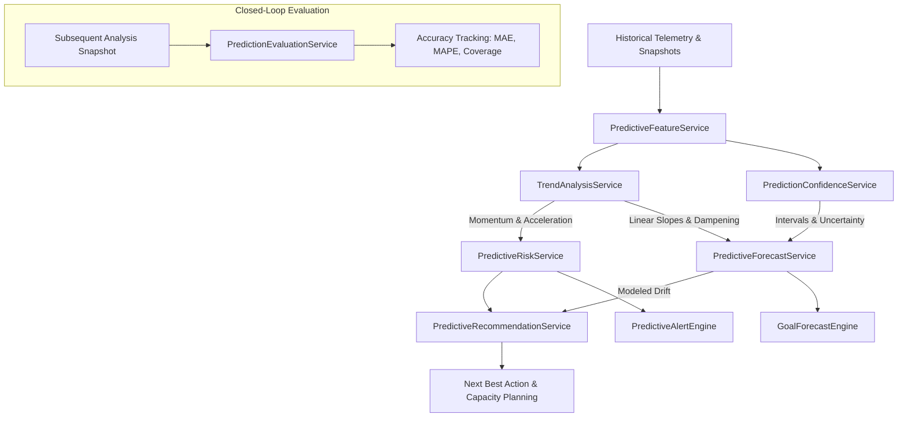

# DebtLens AI — System Architecture Specification (Phase 1 & Phase 2)

DebtLens AI is an enterprise-grade technical debt intelligence and financial quantification platform designed to bridge source code telemetry with executive financial governance.

In **Phase 2**, the platform is enhanced with a **Real Git Repository Ingestion & Technical Debt Analysis Engine**, safely ingesting remote HTTPS repositories, computing AST cyclomatic complexity, calculating commit churn and defect signals, and streaming live progress to the Next.js user interface.

---

## 1. Architectural Philosophy & Technology Stack

The platform strictly adheres to the organization's mandatory standard technology stack:

- **Frontend**: Next.js 16 (App Router), React 19, TypeScript, Tailwind CSS, Lucide Icons, Recharts.
- **Backend**: Node.js, Express.js REST API (`/api` prefix), TypeScript (Strict Mode), `simple-git`, TypeScript Compiler API (`ts.createSourceFile`).
- **Database**: MongoDB with Mongoose ODM (10 domain collections, compound indexing, zero stored credentials, memory fallback).
- **Architecture Flow**:
  $$\text{Next.js Frontend (Port 3000)} \longleftrightarrow \text{Express.js API (Port 5001)} \longleftrightarrow \text{MongoDB (Port 27017)}$$

---

## 2. Phase 2 Real Ingestion Engine Architecture

```
                       Repository Registration / Analysis Request
                                         │
                                         ▼
                     ┌───────────────────────────────────────┐
                     │       RepositorySecurityService       │
                     │  • SSRF Validation (Private IPs/Meta) │
                     │  • Command Injection Rejection        │
                     │  • Workspace Path Traversal Bounds    │
                     └───────────────────┬───────────────────┘
                                         │
                                         ▼
                     ┌───────────────────────────────────────┐
                     │        RepositoryCloneService         │
                     │  • Isolated Sandbox (.analysis-work)  │
                     │  • Shallow Depth (--depth=500)        │
                     │  • Size Limit (MAX_REPOSITORY_SIZE_MB)│
                     │  • Timeout Guard (GIT_CLONE_TIMEOUT)  │
                     └───────────────────┬───────────────────┘
                                         │
                                         ▼
                     ┌───────────────────────────────────────┐
                     │          AnalysisOrchestrator         │
                     │  • Lifecycle State Transition Machine │
                     │  • Live Progress & Stage Tracking     │
                     │  • Cancellation Guard & Signals       │
                     └───────┬───────────────────────┬───────┘
                             │                       │
                             ▼                       ▼
            ┌────────────────────────────────┐ ┌────────────────────────────────┐
            │     RealGitHistoryAnalyzer     │ │     RealSourceCodeAnalyzer     │
            │  • Commit Parsing & Diff Diffs │ │  • Safe Path Traversal & Limits│
            │  • Total Churn (Added+Deleted) │ │  • Exclusions (node_modules)   │
            │  • Code Age & Change Freq      │ │  • Line Volume (Code/Blank/Doc)│
            │  • Defect-Fix Heuristic Regex  │ │  • TypeScript AST Parser       │
            │  • Shannon Entropy Ownership   │ │  • Cyclomatic Complexity       │
            └───────────────┬────────────────┘ └───────────────┬────────────────┘
                            │                                  │
                            └────────────────┬─────────────────┘
                                             │
                                             ▼
                     ┌───────────────────────────────────────┐
                     │          RealLegacyAnalyzer           │
                     │  • Code Inactivity vs High Risk Churn │
                     │  • False Positive Prevention          │
                     └───────────────────┬───────────────────┘
                                         │
                                         ▼
                     ┌───────────────────────────────────────┐
                     │     Hotspot & Technical Debt Engine   │
                     │  • Complexity × Churn Ranking         │
                     │  • 0–100 Explainable Debt Score       │
                     │  • Contextual Risk Explanations       │
                     └───────────────────┬───────────────────┘
                                         │
                                         ▼
                     ┌───────────────────────────────────────┐
                     │         Financial Cost Engine         │
                     │  • 4-Quadrant Capital Valuation       │
                     │  • Remediation & Rework Costs         │
                     │  • Avoidable Maintenance Drag         │
                     │  • Complete Mathematical Traces       │
                     └───────────────────┬───────────────────┘
                                         │
                                         ▼
                     ┌───────────────────────────────────────┐
                     │        RepositoryCleanupService       │
                     │  • Safe Directory Removal             │
                     │  • Read-Only Permission Unlocking     │
                     └───────────────────────────────────────┘
```

---

## 3. Analysis Lifecycle State Machine

Analyses advance through strictly governed state transitions managed by `AnalysisOrchestrator`:

| State | Progress | Description |
|---|---|---|
| `QUEUED` | 0% | Analysis request validated and scheduled. |
| `CLONING` | 10% | Secure clone into isolated workspace under resource limits. |
| `ANALYZING` | 25%–50% | Git history extraction, file discovery, and AST parsing. |
| `CALCULATING` | 70%–85% | Churn, ownership, hotspots, debt score, and 4-quadrant valuation. |
| `PERSISTING` | 95% | Writing records to MongoDB (or memory store if offline). |
| `COMPLETED` | 100% | Analysis completed successfully; temporary workspace pruned. |
| `FAILED` | Terminal | Failure recorded with safe sanitised error message; workspace pruned. |
| `CANCELLED` | Terminal | Analysis aborted by user request; workspace pruned. |

---

## 4. AST Analysis & Complexity Engine

DebtLens AI utilizes the **TypeScript Compiler API (`ts.createSourceFile`)** directly to construct Abstract Syntax Trees for JavaScript, TypeScript, JSX, and TSX files without external CLI dependencies:

1. **Cyclomatic Complexity**:
   $$\text{Complexity} = 1 + \sum (\text{If} + \text{Loops} + \text{Case} + \text{Catch} + \text{Ternary} + \text{Logical AND/OR})$$
2. **Nesting Depth**: Evaluates maximal statement block depth traversing function declarations, condition branches, and loops.
3. **AST Structure Counts**: Identifies and counts functions (methods, arrow functions), classes, import declarations, and export statements.
4. **Unsupported Languages**: Files in languages where AST analysis is not currently enabled return `analysisStatus: "PARTIAL"` or `cyclomaticComplexity: null`. No fabricated metrics are produced.

---

## 5. Security & Isolation Safeguards

- **SSRF Prevention**: URL validation blocks IPv4 loopback (`127.0.0.0/8`), RFC 1918 private subnets (`10.0.0.0/8`, `172.16.0.0/12`, `192.168.0.0/16`), link-local addresses (`169.254.0.0/16`), IPv6 (`::1`, `fe80::`), and cloud metadata services (`169.254.169.254`, `metadata.google.internal`).
- **Command Injection Prevention**: All Git commands are invoked via `simple-git` passing typed argument arrays, completely eliminating `child_process.exec()` shell interpolation.
- **Resource Limits**:
  - `MAX_REPOSITORY_SIZE_MB`: 250 MB
  - `MAX_ANALYSIS_FILES`: 2,000 files
  - `MAX_FILE_SIZE_MB`: 2 MB
  - `MAX_COMMITS`: 500 commits
  - `GIT_CLONE_TIMEOUT_MS`: 60,000 ms
  - `ANALYSIS_TIMEOUT_MS`: 120,000 ms
- **Path Traversal Protection**: All temporary workspaces and file read paths are checked with `isSafeWorkspacePath` to prevent access to parent directories (`..`).
- **Workspace Cleanup**: Every clone is isolated in `.analysis-workspaces/analysis-{id}` and deterministically removed post-analysis in a `finally` block with write permission unlocking.

---

## 6. Real vs Demo Mode Transparency

The platform enforces absolute separation between demo benchmarks and real Git analytics:
- Demo repositories have `isDemo: true` and serve static benchmark models from `DemoDataService`.
- Real repositories have `isDemo: false` and are populated exclusively by `AnalysisOrchestrator`.
- The Next.js frontend renders an emerald telemetry badge for real repositories and an amber banner for demo data. If any metric cannot be derived from Git or AST parsing, it displays `N/A` or `Insufficient data` rather than generating synthetic approximations.

---

## 7. Phase 3 Financial Intelligence & Decision Support Layer

Phase 3 introduces the executive decision-support pipeline layered over real repository telemetry:

```text
REAL REPOSITORY
      ↓
REAL ENGINEERING TELEMETRY (Commits, AST, Churn, Defect Commits, Age, Ownership)
      ↓
TECHNICAL DEBT SIGNALS (Complexity, Hotspots, Stagnation)
      ↓
HOTSPOTS RANKING
      ↓
COST DRIVER ENGINE (Maintenance, Defect/Fix, Change Friction, Legacy Risk)
      ↓
FOUR-QUADRANT FINANCIAL MODEL (Uncertainty Ranges, Currency Config: INR/USD/EUR/GBP)
      ↓
PRIORITIZATION ENGINE (5-Signal Score, Priority Tiers, Impact vs Effort Matrix)
      ↓
WHAT-IF SCENARIO SIMULATOR (Remediation Effectiveness, Refactoring Hours, ROI, Payback)
      ↓
PORTFOLIO AGGREGATOR & HISTORICAL TREND COMPARISON
      ↓
EXECUTIVE BRIEFING GENERATOR (Markdown Brief, Observed vs Modeled Signal Trace)
```

### Backend Service Architecture

```text
backend/src/services/
├── financial/
│   ├── CostModel.ts                    # Central currency, assumptions, and range calculator
│   ├── CostDriverEngine.ts             # 4-quadrant driver breakdown summing to 100%
│   ├── FinancialTraceService.ts        # Audit calculation traces per metric
│   ├── SavingsEngine.ts                # Modeled annual savings & residual friction
│   ├── ROICalculator.ts                # 24-month gross/net benefit, ROI %, payback horizon
│   ├── ScenarioEngine.ts               # Custom What-If simulations & 3 preset comparisons
│   └── FinancialIntelligenceEngine.ts  # Master orchestrator for complete financial valuation
│
├── prioritization/
│   ├── ImpactScoreEngine.ts            # Refactoring effort estimation & normalized scores
│   ├── DebtPrioritizationEngine.ts     # Multi-signal ranking & Impact vs Effort classification
│   └── PortfolioPrioritizationService.ts # Multi-repository organizational aggregation
│
└── reporting/
    ├── DebtSummaryService.ts           # Historical comparison between two completed analyses
    └── ExecutiveReportService.ts       # Synthesizes 10-section executive briefing & Markdown
```

---

## 8. Phase 4 Continuous Action, Intelligence & Verified Debt Reduction

Phase 4 closes the loop, evolving DebtLens AI into a continuous engineering intelligence platform:

```text
GitHub / Git Repository
        ↓
Repository Connection (OAuth 2.0 / Webhooks)
        ↓
Continuous Scheduler (Manual, Daily, Weekly, After-Push)
        ↓
Existing Phase 2 Analysis Engine
        ↓
Analysis Snapshot (Point-in-Time Metrics & Cost Drivers)
        ↓
Debt Identity Engine (Deterministic SHA-256 ID, Line-Shift Immune)
        ↓
Debt Lifecycle State Machine (DETECTED → PRIORITIZED → PLANNED → IN_PROGRESS → RESOLVED → VERIFIED)
        ↓
Action Tracking (Assignee, Target Date, Commit SHA, PR Link)
        ↓
Re-Analysis Trigger
        ↓
Automated Verification Engine (Before vs After Metric Comparison)
        ↓
Goal Progress Engine (Target Tracking with Zero-Span Safety)
        ↓
Alert Engine (Threshold Breach Alerts with 24h Deduplication)
        ↓
Audit Trail Service (Immutable Lifecycle & Engineering Log)
```

### Phase 4 Backend Structure

```text
backend/src/
├── models/
│   ├── RepositoryConnection.ts         # Connection state, OAuth tokens, schedules, webhooks
│   ├── AnalysisSnapshot.ts             # Chronological point-in-time telemetry & exposure
│   ├── DebtItem.ts                     # Persistent debt item identity, lifecycle, & work links
│   ├── EngineeringGoal.ts              # Measurable goals, target values, & progress tracking
│   ├── EngineeringAlert.ts             # Threshold alerts, severities, & dismissal states
│   ├── AuditEvent.ts                   # Immutable chronological engineering action log
│   ├── PredictiveAssessment.ts         # Phase 5: Forecasted risk, multi-horizon metrics, traces
│   └── PredictionEvaluation.ts         # Phase 5: Prediction vs actual evaluation and accuracy audit
│
├── services/
│   ├── predictive/                     # Phase 5: Predictive Engineering Intelligence
│   │   ├── PredictiveFeatureService.ts     # Multi-snapshot historical feature extraction
│   │   ├── TrendAnalysisService.ts        # Slope regression, volatility, acceleration detection
│   │   ├── PredictiveRiskService.ts        # 0–100 predictive risk score, tiers, factor drivers
│   │   ├── PredictionConfidenceService.ts  # Confidence levels, uncertainty intervals (low/exp/high)
│   │   ├── PredictiveForecastService.ts    # Multi-horizon debt & financial drift, what-if scenarios
│   │   ├── PredictiveRecommendationService.ts # Next Best Actions, knapsack capacity planning
│   │   ├── GoalForecastEngine.ts           # Goal completion trajectory & risk estimation
│   │   ├── PredictiveAlertEngine.ts        # Predictive early warning alerts with 24h deduplication
│   │   ├── PredictionEvaluationService.ts  # Retrospective accuracy evaluation (MAE, MAPE, coverage)
│   │   └── PredictiveOrchestrator.ts       # Coordinator, caching, and auto-refresh hooks
│   │
│   ├── github/
│   │   └── GitHubIntegrationService.ts # OAuth 2.0 exchange, HMAC-SHA256 webhooks, repo fetch
│   ├── scheduler/
│   │   └── ScheduledAnalysisService.ts # Recurrence timers, queue debouncing, worker loop
│   ├── reporting/
│   │   ├── AnalysisSnapshotService.ts  # Historical snapshot persistence & chronological queries
│   │   └── SnapshotComparisonEngine.ts # Granular Δ, % improvement, and change classification
│   ├── lifecycle/
│   │   ├── DebtIdentityService.ts      # Deterministic line-shift-immune ID generator
│   │   └── DebtLifecycleService.ts     # Validated state transitions & work linking
│   ├── verification/
│   │   └── VerificationEngine.ts       # Automated Before/After verification (≥20% VERIFIED)
│   ├── goals/
│   │   └── GoalProgressEngine.ts       # Decreasing/increasing metric progress calculations
│   ├── alerts/
│   │   └── AlertEngine.ts              # Threshold alert dispatcher with 24h deduplication
│   └── audit/
│       └── AuditTrailService.ts        # Immutable action recorder
│
└── controllers/
    ├── phase4Controller.ts             # REST endpoints for GitHub, connections, debt, goals, alerts
    └── predictiveController.ts         # Phase 5 REST endpoints for forecasting, scenarios, planning
```

---

## 7. Phase 5 Predictive Intelligence Engine Flow


